  

  

  
  
  

---

## 👋 About Me

Hi, I'm **Rahi Ghodke**, a data science student who loves finding the story hidden in data. I build projects across analytics, machine learning and databases, and I'm always looking for the next problem to solve.

| | |
|---|---|
| 🔭 **Working on** | *[your current project]* |
| 🌱 **Learning** | *[deep learning, SQL optimisation, data visualisation]* |
| 🎯 **Goal** | Internships and real-world data projects |
| 💬 **Ask me about** | Python, data analysis, ML basics, SQL |
| ⚡ **Fun fact** | *[add something personal]* |

---

## 🛠️ Tech Stack

  
  
  
  
  
  
  
  
  
  

**Focus areas:** `Data Science` · `Analytics` · `AI` · `Machine Learning` · `DBMS`

---

## 📌 Featured Projects

<table>
  <tr>
    <td width="33%" valign="top">
      <h3>📈 Project One</h3>
      
One line about the problem you solved and the result.

      
<code>Python</code> <code>Pandas</code>

      <a href="https://github.com/Rahighodke22/project-1">View project →</a>
    </td>
    <td width="33%" valign="top">
      <h3>🤖 Project Two</h3>
      
One line about the problem you solved and the result.

      
<code>Scikit-learn</code> <code>ML</code>

      <a href="https://github.com/Rahighodke22/project-2">View project →</a>
    </td>
    <td width="33%" valign="top">
      <h3>🗄️ Project Three</h3>
      
One line about the problem you solved and the result.

      
<code>SQL</code> <code>MySQL</code>

      <a href="https://github.com/Rahighodke22/project-3">View project →</a>
    </td>
  </tr>
</table>

---

## 🔥 GitHub Streak

  

## 📅 Contribution Graph

  

---

## 📫 Let's Connect

  
  
  

<i>Thanks for stopping by. Let's build something with data. ✨</i>

